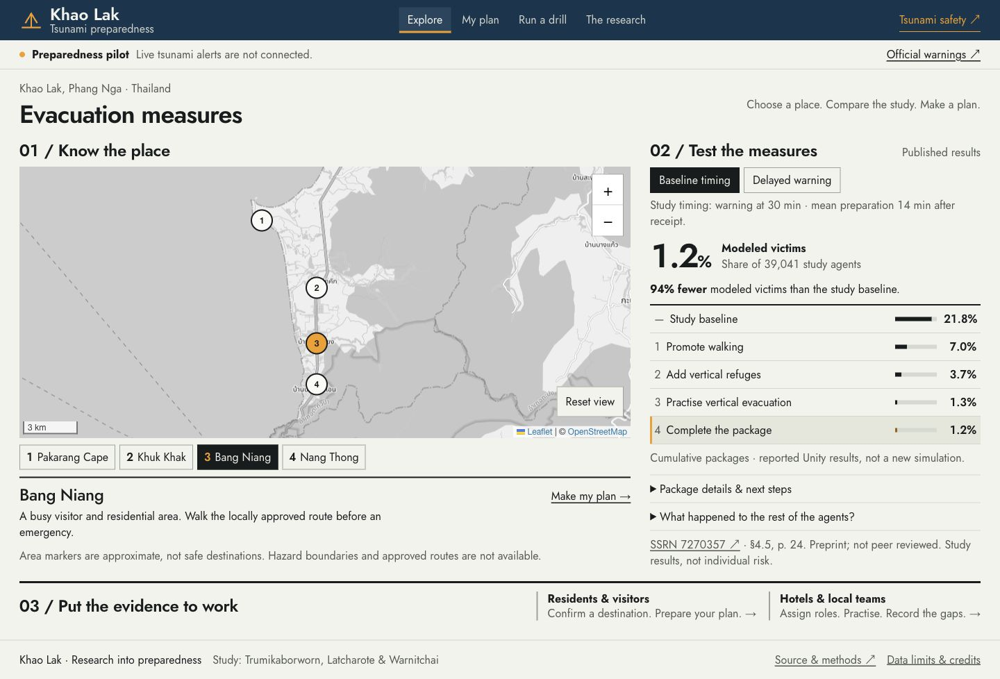

# Khao Lak Tsunami Preparedness

A research-informed planning pilot for residents, visitors, hotels and local teams in Khao Lak, Thailand.

**Intended canonical address:** https://tsunami.nonarkara.org/  
**Repository:** https://github.com/Nonarkara/tsunami-evacuation  
**Maturity:** planning pilot. No real-time warning feed, validated evacuation routing or operational refuge inventory.

The application translates the supplied preprint into four working views. It preserves the original model's authorship and published results; it does not claim to run or replace the Unity simulation.



## What works

- **Explore:** interactive Leaflet map, four approximate named area markers, zoom/reset and keyboard area controls. The map provides geographic orientation. No made-up flood boundary or approved refuge pins.
- **Compare:** five cumulative intervention packages under baseline and delayed conditions. Reported victim shares, same-condition relative reduction, source references and outcome-category explanation. Expanded package details give a practical next step.
- **My plan:** destination, backup, route, assistance and contact fields; readiness checklist; explicit on-device save/load/remove; JSON export and printable full notes. Unsaved entries survive in-app tab changes. A simple distance/speed estimate supports rehearsal, without a tsunami deadline or safety score.
- **Run a drill:** five protocol stages with assigned roles, validated aggregate headcounts, unaccounted-for count, action owner/review date and JSON export. The print view includes all five stage descriptions.
- **Research:** author credit, source ledger, model assumptions, the unresolved Table 3 pedestrian-value inconsistency, privacy boundaries and an operational data handover checklist.
- **Safety guidance:** short English/Thai instructions with NOAA/NWS and Thai authority links. This is general preparation guidance, not an alert service.

## Start locally

Requires Node.js 22+ and npm.

```sh
npm ci
npm test
npm run build
npm run dev
```

Vite prints the local address. `npm run preview` serves the built application. CI runs tests, production compilation and contrast checks on each push and pull request.

## Framework lineage

React 19, TypeScript, Vite and Leaflet. Axiom Design Core's MIT token foundation is reused with project-specific accessible typography and current workspace design rules. Palette Plate 002 supplies the Dark Tyrian Blue / Yellow Orange relationship: a bounded blue masthead, neutral reading surfaces and sparse amber actions. Jost is self-hosted. See [architecture](docs/ARCHITECTURE.md) and [Palette provenance](docs/PALETTE.md).

## Evidence and interpretation

The source is *Agent-Based Modeling and Simulation for Identifying Effective Measures on Tsunami Evacuation in Khao Lak, Thailand*, by Nattapon Trumikaborworn, Panon Latcharote and Pennung Warnitchai. [SSRN 7270357](https://ssrn.com/abstract=7270357). The supplied document states that it is a preprint and has not been peer reviewed.

| Cumulative package | Baseline timing victims | Delayed conditions victims |
|---|---:|---:|
| Study baseline | 21.8% | 22.6% |
| Promote walking (PD50) | 7.0% | 10.6% |
| Add 14 candidate vertical buildings | 3.7% | 5.6% |
| Promote vertical preference | 1.3% | 3.4% |
| Expand signs to 135 | 1.2% | 2.9% |

These are historical simulation outcomes for 39,041 agents. They are not current local conditions, predictions or individual survival probabilities. The app does not interpolate unsupported combinations. The original paper is linked rather than redistributed. See the [research extraction](docs/RESEARCH.md) for sections, assumptions, accounting and author questions.

## What is needed next

1. Obtain the author's Unity source, environment GIS, surveyed behavior distributions, scenario configurations and reproducible run outputs.
2. Obtain dated, licensed hazard polygons, locally approved route networks and destination inventories from responsible authorities.
3. Verify vertical-refuge engineering, capacity, access, ownership and assistance arrangements; candidate buildings are not automatically safe.
4. Run observed field trials with residents, hotel staff, visitors, older people and people with disabilities. Review the full Thai interface with local users before introducing one.
5. Assign an operating team to maintain public guidance, record revisions and approve changes. Define a real official alert integration before making any live-warning claim.

The [data handover specification](docs/DATA-HANDOVER.md) lists the fields and acceptance criteria. No personal information from research surveys should be placed in this repository.

## Privacy

No backend or analytics endpoint. Personal plans and exercise records are never uploaded. Explicit save uses localStorage; anyone sharing the browser profile may read it. The remove button deletes that saved copy. Map tiles are requested from OpenStreetMap, which receives the ordinary network metadata needed to serve them. Hosting services can retain their normal access logs. Download or print a plan for use without connectivity; there is deliberately no unreviewed offline emergency cache.

## Deployment

Canonical hosting configuration: `wrangler.jsonc`; build output: `dist/`. Run `npm run deploy` after authenticating the operator with Cloudflare. The release command gates deployment on tests, the production build and contrast checks. GitHub Actions validates changes but does not automatically deploy. A separately published initial Sites snapshot is described in [deployment notes](docs/DEPLOYMENT.md); `.openai/hosting.json` preserves that snapshot identity. Never store short-lived source or Cloudflare credentials in this repository.

See [verification](docs/VERIFICATION.md) for actual checks and known limits. The release must be checked at the final public hostname; a successful build alone is insufficient.

## License and credits

Original application code: MIT; see LICENSE. Upstream Axiom and Palette notices are in `public/vendor/`. The source research, third-party maps, fonts and their respective rights remain with their authors. No endorsement by the authors or public agencies is implied.
